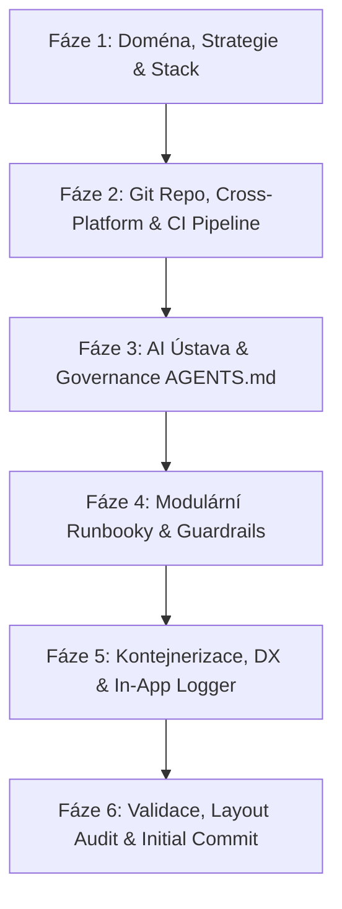

# AI Project Architect (AIDD v3 — Listopad 2026)

Tento autoritativní skill slouží k zakládání, scaffoldingu a architektuře nových softwarových projektů, které jsou od prvního řádku kódu navržené pro spolehlivý, transparentní a vysoce efektivní vývoj ve spolupráci s moderními AI agenty (**Google Antigravity IDE**, **Cursor**, **Claude Code**, **VS Code / Kilo Code**, **GitHub Copilot**).

Vychází z produkčních zkušeností z vývoje systémů **ChronicleForge-2D** a **StoryForge** (v0.8.0).

---

## 1. Filozofie moderního AIDD (Listopad 2026 Standard)

Tradiční přístup k AI vývoji (jeden monolitický instrukční soubor nebo chaotické chatování) selhává ihned po překročení několika tisíc řádků kódu. Architektura AIDD v3 staví na 8 pevných pilířích:

1. **Ústava projektu (`AGENTS.md`) jako Single Source of Truth:**
   - Centrální kotva obsahující striktní *Non-negotiables*, technologické standardy, sémantiku verzování a *Skill Routing tabulku*.
   - Ostatní nástroje (`CLAUDE.md`, `.cursorrules`, `.github/copilot-instructions.md`, `.kilorules`) obsahují pouze tenké ukazatele odkazující přímo na `AGENTS.md`.
2. **Modulární dovednosti (Skills / Progressive Disclosure):**
   - Specializovaná pravidla (chirurgický bugfix, batch runner, ochrana UI layoutu, správa issues, specifikace) jsou uložena v samostatných runboocích (`.agents/skills/` nebo `.github/skills/`). Nezaplňují zbytečně kontextové okno modelu a aktivují se přesně podle typu úkolu.
3. **Fail-Fast & Anti-Rationalization Guardrails:**
   - Zákaz tichých runtime fallbacků (`||`, `??`) na doménových datech.
   - Zákaz obcházení typů (`any`, nepodložené přetypování).
   - Zákaz placeholderů a nekompletního kódu (`// ... existing code ...`, `// TODO`).
   - Zákaz nekrytých API klíčů v repozitáři nebo v nezabezpečených logách.
4. **Dvouúrovňová autonomie agenta (`guided` vs. `batch_run`):**
   - Podpora jak interaktivního vedení krok za krokem (`guided`), tak plně autonomního dávkového odbavování fronty úkolů (`batch_run [issues...]`).
   - V dávkovém režimu je agent chráněn mechanismem **Dynamic Re-evaluation Gate**, který po každém vyřešeném issue re-evaluuje stav repozitáře a chrání předchozí řešení před nechtěnou regresí.
5. **Kontejnerizace s okamžitým HMR na Windows & Linuxu:**
   - Docker Compose se souborovým pollingem (`CHOKIDAR_USEPOLLING=true`, `usePolling: true`) pro spolehlivý Hot Module Replacement na Windows Docker Desktop (WSL2 / Hyper-V).
   - Striktní loopback bind (`127.0.0.1:<port>`) a alokace limitů CPU a paměti, aby kontejner nevysál prostředky pro lokální modely a IDE.
6. **Vizuální ochrana layoutu (UI Layout Guard):**
   - Striktní uzavření viewportu (`h-screen overflow-hidden`), prevence přetečení flexboxu (`min-w-0`), standardizovaná sémantická stupnice vrstev (Z-Index 0–60), runtime In-App Layout Guardian a headless ověřování bounding boxů.
7. **In-App Diagnostika & Logger od Day 1:**
   - Integrovaný in-memory ring buffer (500 záznamů v RAM) s automatickou cenzurou API klíčů a tokenů a 1-click Markdown reportem optimalizovaným pro předání AI agentovi.
8. **Spec-Driven Development (OpenSpec Standard) pro velké celky:**
   - Specifikace je modrotisk; kód je pouhý downstream artefakt. Agilní spojení **Lastenheftu** (požadavků, hodnoty a hranic) a **Pflichtenheftu** (technických Zod schémat a kontrolních bodů) před napsáním kódu. Lze aktivovat od Day 1 nebo kdykoliv později, jakmile projekt roste do komplexity.

---

## 2. Kontext prostředí & Výchozí předpoklady

Při inicializaci vždy respektuj:
- **Dual-boot a Multiplatformní integrita:** Windows 11 / Linux (Pop!_OS/Ubuntu/macOS) $\rightarrow$ textové soubory musí mít vynuceno `eol=lf` přes `.gitattributes` a skripty spustitelné na obou platformách.
- **Hardware ohleduplnost:** Vývojářský stroj často provozuje lokální LLM, Antigravity/Cursor a kontejnery současně. Kontejnery a buildy musí respektovat alokační stropy (výchozí limit: max 2 GB RAM a 2 CPU na dev službu).
- **Tooling & MCP Integrace:**
  - Využívej globální MCP server `context7` k ověřování aktuálních verzí frameworků (React, Vite, Next.js, Tailwind v4, Zod, Vitest atd.).
  - Pro práci s GitHub Issues a repozitářem preferuj oficiální `gh` CLI.
  - V Antigravity IDE respektuj pravidla sandboxu (pnpm instalace prováděj dle potřeby, buildy a testy sandboxovaně).
- **Výhradně relativní cesty:** Žádné absolutní cesty (`file:///C:/...` nebo `D:\...`) v dokumentaci ani v konfiguracích. Vše musí být přenositelné.
- **Žádný push ani bump verze bez povolení:** Zákaz spouštění `git push` a zákaz vytváření nové verze v `package.json` / git tagu bez výslovného souhlasu uživatele.

---

## 3. Fázový postup inicializace projektu



---

### Fáze 1: Doména, Strategie, Tech Stack a Režim Autonomie

1. **Strukturované zjištění požadavků uživatele:**
   - **Doména a cíl:** Webová aplikace, backend API, desktop nástroj, herní engine, CLI.
   - **Požadavky na rozhraní:** Jednostránkový editor / dashboard (h-screen bez scrollu celého okna), dokumentační web se scrollem, nebo bez UI.
   - **Technologické preference:** Preferovaný jazyk (TypeScript, Python, Rust, Go), framework (React, Next.js, Fastify, FastAPI), styling (Tailwind CSS v4).
   - **Autonomie vývoje:** Přednostní režim spolupráce (`guided` pro těsnou konzultaci vs. `batch_run` pro rychlé odbavování dávek).
   - **Specifikace vs. Issues (OpenSpec):** Zda projekt začíná se Spec-Driven workflow (`docs/specs/` a `docs/proposals/`) pro komplexní domény, nebo čistě přes GitHub Issues (s tím, že OpenSpec lze kdykoliv aktivovat později při škálování).
2. **Ověření stacku přes `context7`:**
   - Zkontroluj aktuální stabilní verze a best practices zvolených knihoven.
3. **Předložení návrhu architektury ke schválení:**
   - Runtime, bundler a hlavní knihovny.
   - Typové schéma (např. Zod pro TypeScript, Pydantic pro Python).
   - Testovací framework (Vitest, Playwright, Pytest) a linter (ESLint + Biome / Ruff).
4. **Čekej na potvrzení uživatele.**

---

### Fáze 2: Git Repozitář, Cross-Platform Interoperabilita & CI/CD Pipeline

1. **Inicializace repozitáře:** `git init` (pokud již není inicializován).
2. **Instalace `.gitattributes`:**
   - Zkopíruj šablonu z `templates/gitattributes.template`.
   - Vynucuje `eol=lf` pro veškeré textové soubory a deklaruje binární formáty.
3. **Instalace `.gitignore`:**
   - Šitý na míru zvolenému stacku (`node_modules/`, `dist/`, `.env.local`, `.venv/`, `target/`), OS artefaktům (`Thumbs.db`, `.DS_Store`) a AI editorům (`.agents/`, `.cursor/`, `.kilo/` lokální cache).
4. **Instalace GitHub Actions CI/CD Pipeline od Day 1 (`.github/workflows/ci.yml`):**
   - Zkopíruj a adaptuj šablonu z `templates/ci.template.yml`.
   - Pipeline běží na `ubuntu-latest`, spouští se na `push` a `pull_request` na hlavní větve.
   - Zahrnuje kroky: `checkout`, instalace s cache a frozen lockfile, `lint`, `typecheck`, `test`, `build`.
   - Concurrency zámek zabraňuje plýtvání CI minutami při rychlých pushích (`cancel-in-progress: true`).
5. **Volitelné propojení s GitHubem:**
   - Pokud uživatel požaduje, vytvoř repozitář přes `gh repo create` (s volbou `private` / `public`).

---

### Fáze 3: AI Governance & Ústava projektu (The Constitution)

1. **Instalace `AGENTS.md` (Ústava projektu):**
   - Zkopíruj a vyplň šablonu z `templates/AGENTS.template.md`.
   - Vyplň zvolený stack, architektonický vzor a rozvržení složek.
   - Definuj Non-negotiables (Fail-fast, zero "any", zákaz neřízených mutací, relativní odkazy, ochrana API klíčů).
   - Nastav Skill Routing Table a definice režimů `guided` a `batch_run`.
   - Zakotvi Release Approval Gate (zákaz automatického bumpu verzí a tagů bez výslovného souhlasu uživatele).
2. **Propojení editorů (Thin Pointers):**
   - Vytvoř lehká propojení odkazující na `AGENTS.md`:
     - `CLAUDE.md`: `See ./AGENTS.md for all project instructions, rules, and architecture guidelines.`
     - `.cursorrules`: `See ./AGENTS.md for authoritative coding rules and project constitution.`
     - `.github/copilot-instructions.md`: `Follow all rules and architecture defined in ./AGENTS.md.`
     - `.kilorules`: `Refer to ./AGENTS.md for project standards.`
3. **Příprava dokumentačního stromu `docs/`:**
   - `docs/ARCHITECTURE.md` — Návrh toků dat, modulárních rozhraní a diagramů.
   - `docs/CHANGELOG.md` — Založen se sekcí `## [Unreleased]`.
   - `docs/PROGRESS.md` — Pro sledování kontextu a checkpointů napříč sezeními.

---

### Fáze 4: Modulární Skills & Guardrails (Runbooks)

Nainstaluj sadu specializovaných runbooků do `.agents/skills/` (nebo `.github/skills/` dle preferencí týmu):

1. **`bug-fixing-protocol`:**
   - Ze šablony `templates/bug-fixing-protocol.template.md`.
   - Princip chirurgického řezu, Laser Focus, zákaz tichých polyfillů `||` a `??`, TDD test před opravou, povinná Definition of Done.
2. **`batch-runner-protocol`:**
   - Ze šablony `templates/batch-runner-protocol.template.md`.
   - Řídí autonomní režim odbavování více úkolů (`batch_run`).
   - Sestavení Dependency & Impact Matrix předem, povinný **Dynamic Re-evaluation Gate** před každým krokem a atomické commity per issue.
3. **`ui-layout-guard-protocol` (pro frontendové projekty):**
   - Ze šablony `templates/ui-layout-guard-protocol.template.md`.
   - Strict Viewport Containment, flexbox `min-w-0` pravidlo, sémantická Z-Index stupnice (0 až 60), In-App layout guardian a instrukce pro headless prohlížeč.
4. **`github-issues-protocol`:**
   - Ze šablony `templates/github-issues-protocol.template.md`.
   - Správa chyb, čtení, zakládání a komentování issues přes `gh` CLI bez tokenových přepadů.
5. **`spec-driven-protocol` (OpenSpec Standard):**
   - Ze šablony `templates/spec-driven-protocol.template.md` a `templates/proposal.template.md`.
   - Řídí životní cyklus velkých funkcí (`spec_propose` $\rightarrow$ `spec_apply` $\rightarrow$ `spec_archive`), přípravu mini-Lastenheftu a technických Zod schémat před psaním kódu.
6. **Projektový Master Architect skill (`<project>-aidd-architect`):**
   - Specializovaný autoritativní skill šitý na míru konkrétní doméně daného projektu.

---

### Fáze 5: Kontejnerizace, Vývojářské DX & In-App Diagnostika od Day 1

1. **Kontejnerizace prostředí pro okamžitý HMR na Windows & Linuxu:**
   - Vytvoř `Dockerfile` s multi-stage strukturou (dev vs. prod cíl).
   - Vytvoř `docker-compose.yml` ze šablony `templates/docker-compose.template.yml`:
     - Podpora Windows Docker Desktop: nastaveny proměnné `CHOKIDAR_USEPOLLING=true`, `WATCHPACK_POLLING=true` a bundler watcher polling.
     - Bezpečnost: porty svázány na loopback `127.0.0.1:<port>`.
     - Ochrana paměti: nastaveny resource limity (`memory: 2048M`, `cpus: '2.0'`).
     - Volume mapping pro live kód + anonymní volume pro `/app/node_modules`.
2. **In-App Diagnostický Logger od Day 1 (`src/utils/logger.ts`):**
   - Zkopíruj a zprovozni šablonu `templates/logger.template.ts`.
   - In-memory ring buffer (500 položek) v RAM bez zápisu na disk.
   - Automatická cenzura API klíčů (`sk-...`), Bearer tokenů a hesel.
   - Globální zachycení `window.onerror` a `unhandledrejection`.
   - Metoda `logger.exportMarkdownReport()` pro 1-click vygenerování souhrnu pro AI asistenta.
   - (Pro React/UI aplikace) Vytvoř základní modální okno nebo vývojářskou klávesovou zkratku (např. Ctrl+Shift+L) pro zobrazení a export logů.
3. **Vývojářské skripty a konfigurace (`package.json` / `Makefile` / `Taskfile`):**
   - Zadej standardizované skripty:
     - `dev`: Lokální start s live reloadem.
     - `build`: Produkční kompilace.
     - `lint`: Statická analýza a formátování.
     - `typecheck`: Typová kontrola bez generování artefaktů.
     - `test`: Spuštění testovací sady.
     - `test:watch`: Interaktivní testovací režim.
     - `docker:dev`: Spuštění celého stacku přes `docker compose up`.

---

### Fáze 6: Validace, Layout Audit, Sanity Check & Initial Commit

1. **Ověření integrity projektu (Sanity Check):**
   - Spusť validační sadu:
     ```bash
     pnpm run typecheck && pnpm run lint && pnpm run test && pnpm run build
     ```
2. **Vizuální audit & Layout Check (pokud projekt obsahuje UI):**
   - Ověř, že kořenový layout obsahuje `overflow-hidden` a správně rozdělené flexboxy.
   - Zkontroluj, že flex položky s proměnným obsahem mají nastaveno `min-w-0`.
   - Zkontroluj v prohlížeči nebo přes DevTools, že nedochází k horizontálnímu scrollu a že z-index dialogů je konzistentní.
3. **Kontrola relativních odkazů v dokumentaci:**
   - Zkontroluj, že v `AGENTS.md`, `README.md` ani v `docs/` nejsou žádné absolutní cesty.
4. **Zobrazení přehledu vytvořených artefaktů:**
   - Vypiš strom adresářů a souborů.
5. **Návrh Conventional Commit zprávy:**
   - Např.: `chore: initialize project with AIDD v3 architecture, governance, docker, ci and in-app diagnostics`
6. **Release Approval Gate:**
   - **Vyčkej na explicitní schválení uživatele před provedením `git commit` i případného `git push`.**

---

## 4. Režim práce agenta a Autonomie (Reference pro uživatele)

Jakmile je projekt inicializován, uživatel může agenta řídit třemi standardními způsoby:

### A. Interaktivní režim (`guided`)
```text
"Pojďme implementovat autentizaci uživatele."
"Oprav chybu v exportu PDF."
```
Agent provádí změny po jednotlivých logických blocích a ptá se na potvrzení klíčových rozhodnutí.

### B. Autonomní dávkový režim (`batch_run`)
```text
"batch_run: vyřeš issues #5, #8 a #12"
```
Agent aktivuje `batch-runner-protocol`:
1. Zanalyzuje vzájemné závislosti (#5 databáze $\rightarrow$ #8 byznys logika $\rightarrow$ #12 UI).
2. Spustí první issue, implementuje ho, spustí testy a vytvoří atomický commit `fix(#5): ...`.
3. Projde **Dynamic Re-evaluation Gate**: znovu načte modifikované soubory a ověří, zda se nezměnily předpoklady pro issue #8.
4. Vyřeší #8, verifikuje a commitne `feat(#8): ...`.
5. Re-evaluuje a vyřeší #12, verifikuje a commitne `fix(#12): ...`.
6. Předloží celkový souhrn dávky.

### C. Spec-Driven režim (`spec_propose` $\rightarrow$ `spec_apply` $\rightarrow$ `spec_archive`)
```text
"spec_propose: export-epub"
```
Agent aktivuje `spec-driven-protocol`:
1. Vytvoří návrh v `docs/proposals/YYYY-MM-DD-export-epub.md` obsahující Lastenheft (požadavky, meze), Pflichtenheft (Zod/TS schémata) a checklist implementace.
2. **Agent se zastaví a čeká na schválení uživatelem.**
3. Po schválení (`spec_apply: export-epub`) provede implementaci krok za krokem s testy.
4. Po dokončení verifikace (`spec_archive: export-epub`) integruje dokumentaci do `docs/specs/`.

---

## 5. Šablony v repozitáři skillu

Při provádění fází čerpej z připravených souborů ve složce `templates/`:
- `templates/gitattributes.template` $\rightarrow$ `.gitattributes`
- `templates/ci.template.yml` $\rightarrow$ `.github/workflows/ci.yml`
- `templates/docker-compose.template.yml` $\rightarrow$ `docker-compose.yml`
- `templates/logger.template.ts` $\rightarrow$ `src/utils/logger.ts`
- `templates/bug-fixing-protocol.template.md` $\rightarrow$ `.agents/skills/bug-fixing-protocol/SKILL.md`
- `templates/batch-runner-protocol.template.md` $\rightarrow$ `.agents/skills/batch-runner-protocol/SKILL.md`
- `templates/ui-layout-guard-protocol.template.md` $\rightarrow$ `.agents/skills/ui-layout-guard-protocol/SKILL.md`
- `templates/github-issues-protocol.template.md` $\rightarrow$ `.agents/skills/github-issues-protocol/SKILL.md`
- `templates/spec-driven-protocol.template.md` $\rightarrow$ `.agents/skills/spec-driven-protocol/SKILL.md`
- `templates/proposal.template.md` $\rightarrow$ `docs/proposals/proposal.template.md`
- `templates/AGENTS.template.md` $\rightarrow$ `AGENTS.md`
