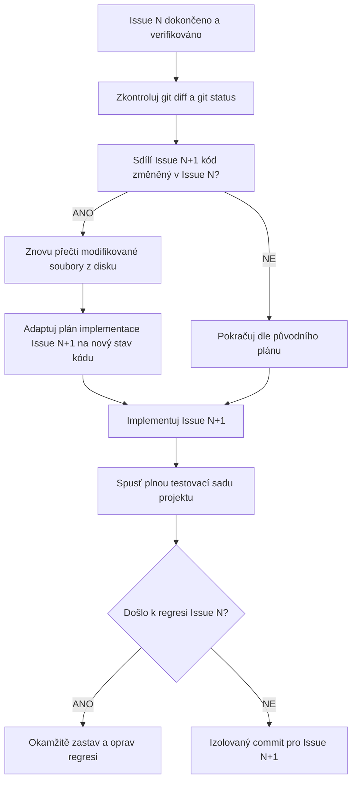

# Protokol pro autonomní dávkové odbavování (Batch Runner Protocol)

> **Účel:** Tento protokol řídí chování AI agenta, pokud obdrží požadavek na vyřešení více issues nebo úkolů najednou v autonomním režimu (`batch_run [issues...]`).
> Zabraňuje typickému problému agentů: **kaskádovému rozpadu architektury**, kdy vyřešení pozdějšího issue rozbije kód dříve dokončeného issue.

---

## Fáze 1: Analýza závislostí & Impact Matrix (Pre-Flight)

Před napsáním jediného řádku kódu musí agent provést globální analýzu všech zadaných issues:

1. **Čtení zadání:** Přečíst plné znění všech dotčených issues (např. přes `gh issue view <id>`).
2. **Identifikace dotčených souborů:** Pro každé issue určit pravděpodobně modifikované soubory a moduly.
3. **Detekce kolizí a závislostí:**
   - Která issue sdílejí stejné soubory, datová schémata nebo stores?
   - Má některé issue prerekvizitu v jiném issue (např. úprava schématu před úpravou UI)?
4. **Sestavení exekuční fronty (Execution Queue):**
   - Seřadit issues do lineární fronty od základních (databáze, schémata, utility) po závislé (byznys logika, UI, export).

---

## Fáze 2: Dynamic Re-evaluation Gate (Klíčový ochranný mechanismus)

> ⚠️ **KRITICKÉ PRAVIDLO:** Agent NIKDY nesmí slepě aplikovat původní plán pro Issue N+1 po dokončení Issue N!

Před zahájením práce na každém dalším issue v dávce musí proběhnout **Dynamic Re-evaluation Gate**:

### Kontrolní otázky Re-evaluation Gate:
1. Změnilo předchozí issue rozhraní, typy nebo návratové hodnoty funkcí, které má následující issue používat?
2. Zůstaly v platnosti původní předpoklady o struktuře komponent nebo storu?
3. Prochází po úpravě všechny testy vytvořené v předchozích issues?

---

## Fáze 3: Atomické commity & Životní cyklus Issue

Každé issue v dávce musí být striktně izolováno:
1. **Jedno issue = Jeden ucelený commit:**
   - Formát: `fix(#12): <popis>` nebo `feat(#15): <popis>`
   - Žádné sloučené monolitické commity pro více nesouvisejících issues.
2. **Okamžitá verifikace před commitem:**
   - `build`, `lint` a `test` musí projít se statusem 0.
3. **Evidence a komentář na GitHubu:**
   - Přidat komentář se shrnutím řešení a případně issue uzavřít (`gh issue close <id> --comment "Vyřešeno v commitu <hash>"`).

---

## Fáze 4: Havarijní stopka (Circuit Breaker)

Pokud během řešení libovolného issue v dávce nastane:
- Neočekávaná cyklická chyba v testech, kterou se nedaří vyřešit do 2 pokusů,
- Architektonický konflikt vyžadující rozhodnutí o rozhraní,
- Selhání kompilace způsobené vzájemnou nekompatibilitou změn,

**Agent je POVINEN okamžitě zastavit autonomní dávku**, zaznamenat stav do `docs/PROGRESS.md`, vrátit repozitář do posledního zeleného commitu a předložit situaci uživateli s jasným dotazem a možnostmi řešení.
