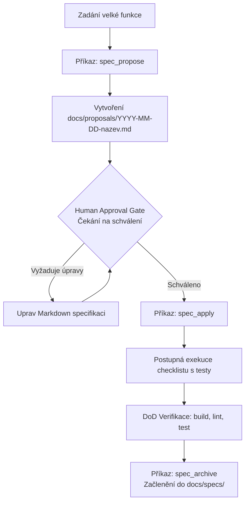

# Spec-Driven Development Protocol (OpenSpec Standard)

> **Základní filozofie:** Specifikace je jediný zdroj pravdy a modrotisk; kód je pouhý odvozený (downstream) artefakt.
> Tento protokol zabraňuje halucinacím a nekontrolovanému driftu kódu (vibe coding) při implementaci velkých funkcí, nových modulů nebo zásadních refaktoringů.

---

## 1. Kdy se protokol aktivuje

- **POVINNĚ:**
  - Přidání nového doménového modulu nebo zásadní nové funkce (např. export do nového formátu, nový subsystém, integrace platební brány).
  - Změny datových kontraktů ovlivňující více vrstev (databáze + store + UI).
  - Složité architektonické refaktoringy.
- **NEPOUŽÍVÁ SE:**
  - Běžné chirurgické opravy chyb (na to slouží `bug-fixing-protocol`).
  - Drobné kosmetické úpravy textů nebo styling v CSS.

---

## 2. Adresářová struktura v projektu

Pokud je v projektu aktivován Spec-Driven Development, repozitář obsahuje:
```
docs/
├── specs/                   # Živé specifikace aktuálního stavu systému (aktuální pravda)
│   ├── auth-spec.md
│   └── data-model-spec.md
└── proposals/               # Aktivní a dokončené návrhy změn (RFC styl)
    ├── 2026-11-25-export-epub.md
    └── archive/
```

---

## 3. Životní cyklus specifikace (Lifecycle)



### Krok 1: `spec_propose [nazev-funkce]`
Agent NIKDY nezačne psát kód aplikace. Místo toho vytvoří soubor `docs/proposals/YYYY-MM-DD-[nazev].md` podle šablony:
1. **Část A: Záměr a Rozsah (Lastenheft / Requirements):**
   - Jaký problém řešíme a pro koho?
   - Co funkce **MUSÍ** umět.
   - Co funkce v této verzi výslovně **NEDĚLÁ** (Out of Scope / Hranice).
2. **Část B: Datové kontrakty & Technické řešení (Pflichtenheft / Tech Spec):**
   - Zod schémata, TypeScript rozhraní nebo databázová schémata.
   - Vybrané knihovny a zdůvodnění volby.
   - Dopad na stávající vrstvy a komponenty.
3. **Část C: Pravidla a Guardrails:**
   - Bezpečnostní a architektonická pravidla (např. ochrana layoutu, z-index, offline podpora, limity paměti).
4. **Část D: Kontrolní seznam implementace (Tasklist):**
   - Očíslované, konkrétní kroky implementace.

> 🛑 **STOP & WAIT:** Po vygenerování návrhu se agent **okamžitě zastaví** a předloží návrh uživateli ke kontrole a schválení.

### Krok 2: `spec_apply [nazev-funkce]`
- Teprve po výslovném schválení uživatelem (např. *„Schváleno“*, *„Můžeš implementovat“*) začne agent kódovat.
- Postupuje přesně podle očíslovaného kontrolního seznamu.
- Každý krok provází unit nebo integrační test ověřující funkčnost kontraktu.

### Krok 3: `spec_archive [nazev-funkce]`
- Po dokončení implementace a úspěšné verifikaci (build + test + lint) se trvalé specifikace integrují do `docs/specs/[modul].md`.
- Návrh se označí jako implementovaný a přesune do archivu.
- Repozitář si tak udržuje **trvalou paměť záměru (Paper Trail)**, která nezmizí po vyčištění chatu.
